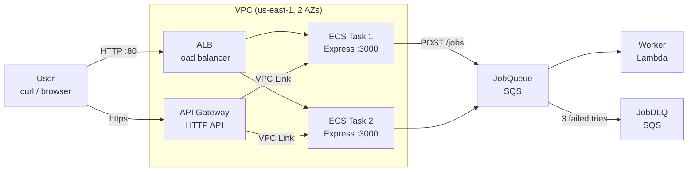

# aws-lab

Hands-on labs for learning AWS one service at a time with SST v4. Each lab ends with a commit and a summary in `docs/labs/`.

## Current architecture



## Labs

| #   | Lab                        | Key concepts                                                                | Notes                                                      |
| --- | -------------------------- | --------------------------------------------------------------------------- | ---------------------------------------------------------- |
| 1   | ECS Fargate + ALB          | Containers, tasks and services, load balancing, health checks, self-healing | [01-ecs-alb.md](docs/labs/01-ecs-alb.md)                   |
| 2   | Lambda + SQS + API Gateway | Queues, async jobs, batches, retries and DLQ, VPC Link, Cloud Map           | [02-lambda-sqs-apigw.md](docs/labs/02-lambda-sqs-apigw.md) |

## Common commands

```bash
aws sso login --profile dev          # log in to AWS (when the token expires)
bun install                          # install dependencies + the pre-commit hook
bun run check                        # lint + format check + type check (same as CI)
bunx sst deploy --stage dev          # create or update everything on AWS
bunx sst remove --stage dev          # delete everything (do this after each lab!)
```

## Tech stack

| Role                   | Tool                                            |
| ---------------------- | ----------------------------------------------- |
| Infrastructure as code | SST v4 (`sst.config.ts`)                        |
| API                    | Express + TypeScript                            |
| Runtime                | Node.js 22 (Docker image `node:22-alpine`)      |
| Package manager        | Bun                                             |
| Lint / format          | oxlint, oxfmt                                   |
| Git hook               | lefthook (pre-commit: format, lint, type check) |
| AWS                    | Region `us-east-1`, profile `dev`               |

> 💸 The ALB (about $16/month) and each Fargate task (about $12/month) cost money for as long as they run. Run `bunx sst remove --stage dev` when you finish a lab.
