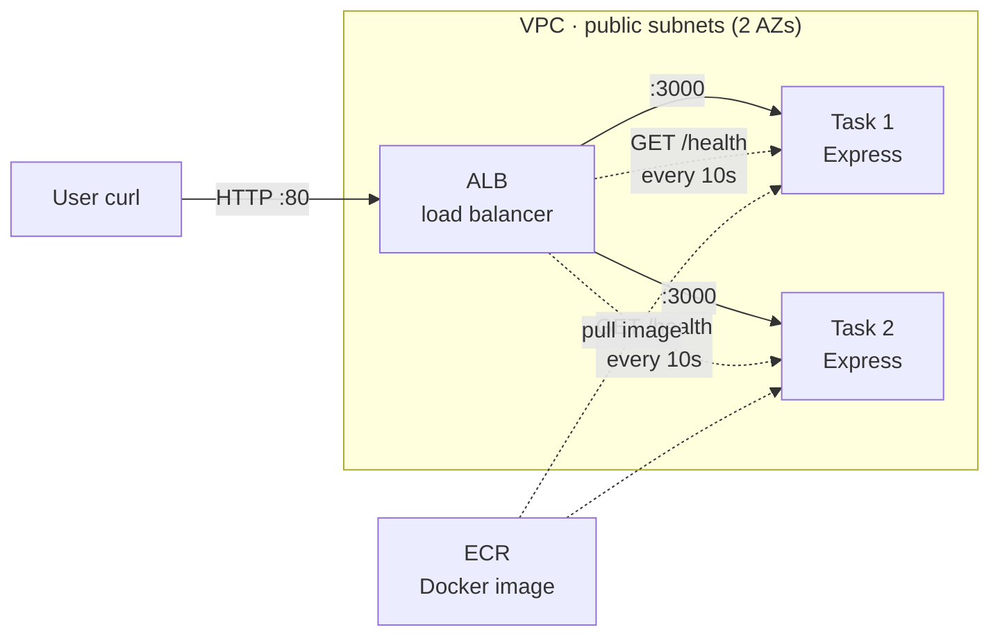
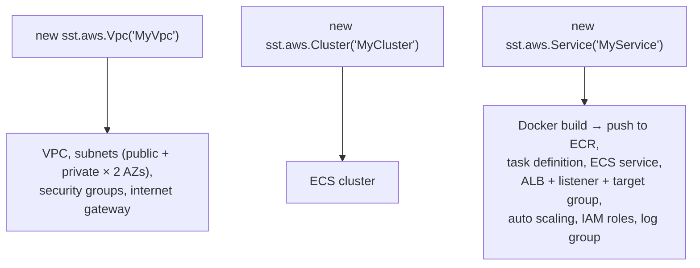
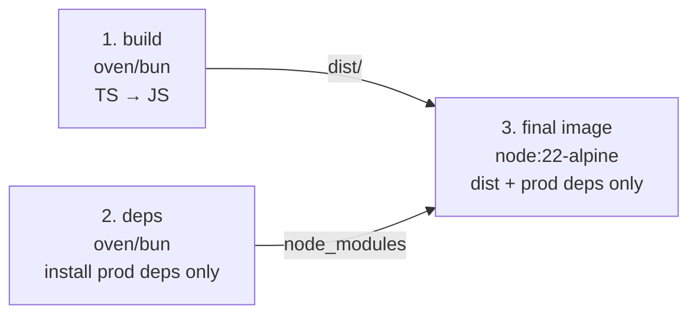
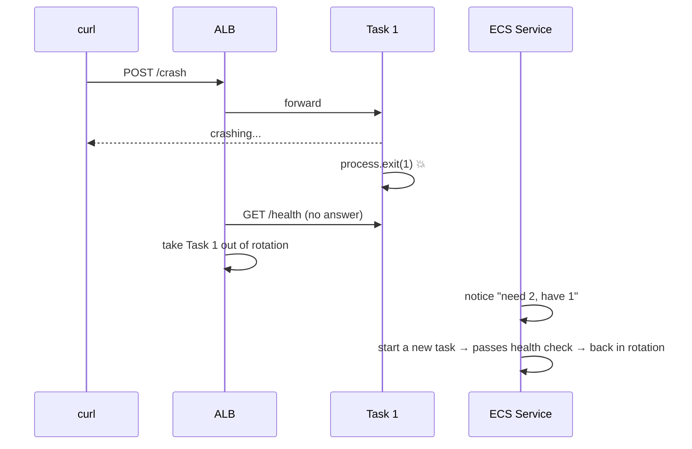

# Lab 1. ECS Fargate + ALB

> Package an Express API as a Docker image, run two copies on **ECS Fargate**, and let an **ALB** spread requests between them. All infrastructure lives in one SST v4 file (`sst.config.ts`).

## At a glance



- Users only know **one address: the ALB's**. The ALB forwards each request to a healthy task.
- Every 10 seconds the ALB calls each task's `/health`. A task that stops answering gets no more traffic.
- The service runs 2 tasks at minimum and 4 at most, scaling on 70% CPU.

## Key concepts (restaurant analogy)

| Concept                         | One-line definition                                              | Restaurant analogy                                                |
| ------------------------------- | ---------------------------------------------------------------- | ----------------------------------------------------------------- |
| **Docker image**                | The app and its runtime packed together                          | A meal kit: tastes the same wherever you heat it                  |
| **ECR**                         | AWS storage for Docker images                                    | The meal-kit warehouse                                            |
| **VPC**                         | Your own isolated network                                        | The restaurant building                                           |
| **Subnet / AZ**                 | A section of the VPC / a physically separate data center         | Branch 1 and branch 2: if one loses power, the other stays open   |
| **ECS cluster**                 | A group for managing tasks                                       | The kitchen                                                       |
| **Task**                        | A running container                                              | One cook                                                          |
| **Service**                     | The rule "always keep N tasks running"                           | The head chef: replaces a cook who collapses                      |
| **Fargate**                     | Run containers without managing servers                          | A staffing agency: sends cooks, you don't deal with their housing |
| **ALB**                         | Spreads incoming requests across tasks                           | The host: seats guests with a free cook                           |
| **Target group / health check** | The list of tasks the ALB can send to / a periodic "are you OK?" | The shift roster / asking "you OK?" every 10 seconds              |
| **Auto scaling**                | Adjusts the task count to the load                               | Calling in extra cooks when it gets busy                          |

## SST code → AWS resources



The key part of `sst.config.ts`:

```ts
const service = new sst.aws.Service("MyService", {
  cluster,
  image: { context: "./", dockerfile: "Dockerfile" },
  cpu: "0.25 vCPU",
  memory: "0.5 GB",
  environment: { PORT: "3000" }, // Express listens here
  scaling: { min: 2, max: 4, cpuUtilization: 70 }, // 2 to 4 tasks by CPU
  loadBalancer: {
    rules: [{ listen: "80/http", forward: "3000/http" }], // ALB :80 → task :3000
    health: { "3000/http": { path: "/health", interval: "10 seconds" } },
  },
})
```

## Docker image: 3-stage build



- **Bun only installs and builds.** **Node.js** runs the app.
- The final image holds just the output (`dist/`) and production dependencies, so it stays small. Dev tools like the TypeScript compiler are left out.
- `.dockerignore` lists `node_modules`, `dist`, `.sst`, and `.git`, so they don't get sent into the build.

## API

| Route         | What it does                                                     |
| ------------- | ---------------------------------------------------------------- |
| `GET /`       | Returns `host` (which task answered), `version`, and `startedAt` |
| `GET /health` | For the ALB health check. Returns `200 ok`                       |
| `POST /crash` | Kills the process on purpose, to watch self-healing              |

## Experiments

### Exp 1. Load balancing ✅

```bash
for i in 1 2 3 4 5 6; do curl -s $URL/ | jq -r .host; done
```

- `host` alternates between two values: the ALB is splitting requests across both tasks.

### Exp 2. Self-healing ✅



- When one task dies, the ALB sends traffic only to the other, so users still get answers.
- The ECS service starts a new task to get back to 2. The new task has a different `host` and `startedAt`.

### Exp 3. Rolling deploy (skipped)

- Change `VERSION` to `v2` and deploy. You would see new tasks start first, pass the health check, and only then the old tasks stop. Try it later.

## Lessons and gotchas

- **SST's default `Vpc` has no NAT.** So tasks run in **public subnets** with public IPs. Private subnets need a NAT and the `containerSubnets` setting.
- **The ALB port and the container port differ.** Users hit the ALB on port 80. The ALB forwards to port 3000 on the task (Express).
- **Keep the health check light:** `/health` returns `200` right away, with no DB or other dependency. A heavy check can pull healthy tasks out of rotation.
- **Put `typescript` in `devDependencies`** so it stays out of the production image.
- **`sst deploy` is not `sst dev`.** `deploy` really deploys to AWS. `dev` is local development mode.
- **Always tear down:** forget it and the ALB, tasks, and public IPs keep billing.

## Cost (while running)

| Resource                                   | Roughly                                              |
| ------------------------------------------ | ---------------------------------------------------- |
| ALB                                        | About $16/month (even with no traffic)               |
| Fargate task (0.25 vCPU, 0.5 GB)           | About $9/month each + about $3.6 for the public IPv4 |
| Cloud Map namespace (created by SST `Vpc`) | About $0.50/month                                    |

## Commands

```bash
docker build -t aws-lab . && docker run --rm -p 3000:3000 aws-lab   # test the image locally
bunx sst deploy --stage dev                                         # deploy
URL=$(jq -r .url .sst/outputs.json)                                 # ALB address
bunx sst remove --stage dev                                         # tear down
```
