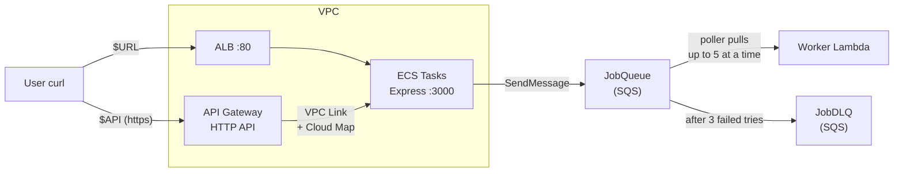
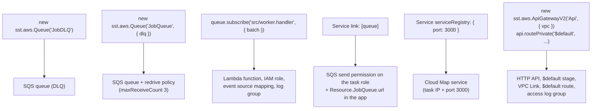
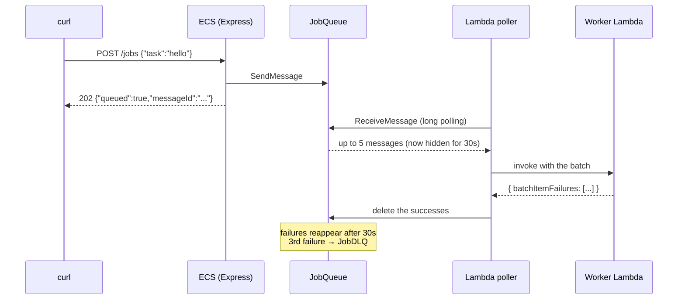
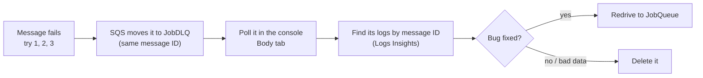

# Lab 2. Lambda + SQS + API Gateway

> Make `POST /jobs` on the ECS API drop the job into an **SQS queue** and answer `202` right away. A **Lambda worker** picks the job up later. Jobs that keep failing land in a **DLQ**. Then put an **API Gateway** in front of the same ECS service as a second entrance.

## At a glance



- The API **only queues** the job and answers `202 Accepted`. The slow work happens later in Lambda.
- When Lambda is down or slow, jobs wait safely in the queue. The queue is a **buffer**.
- API Gateway lives **outside** the VPC (AWS runs it), so it reaches the tasks through a **VPC Link**. **Cloud Map** tells it where the tasks are.

## Key concepts (restaurant analogy)

| Concept                           | One-line definition                                                      | Restaurant analogy                                                       |
| --------------------------------- | ------------------------------------------------------------------------ | ------------------------------------------------------------------------ |
| **SQS queue**                     | Holds messages until someone processes them                              | The order rail in the kitchen                                            |
| **Message**                       | One job (JSON text)                                                      | One order ticket                                                         |
| **Lambda**                        | Code that runs only when there's work, no servers to manage              | A part-time cook who comes in only when there are tickets                |
| **Event source mapping (poller)** | The Lambda service checks the queue and calls your function with a batch | A runner who grabs tickets off the rail and hands them to the cook       |
| **Batch**                         | Several messages handed over in one call                                 | A handful of tickets at once                                             |
| **Visibility timeout (30s)**      | A picked-up message is hidden, then reappears if not deleted             | A ticket taken off the rail goes back up if the dish isn't served in 30s |
| **DLQ**                           | Where messages go after too many failed tries                            | The "problem orders" tray for the manager to look at                     |
| **Cold / warm start**             | First call boots a new environment / later calls reuse it                | Cook arriving and setting up / cook already at the station               |
| **API Gateway (HTTP API)**        | A managed front door for APIs: routes, throttling, logs                  | The front desk of a building                                             |
| **VPC Link**                      | A private tunnel from API Gateway into the VPC                           | A staff-only door from the front desk to the kitchen                     |
| **Cloud Map**                     | A directory of where each task is (IP and port)                          | The staff directory: "cook A is at station 3"                            |

## SST code → AWS resources



The key parts of `sst.config.ts`:

```ts
const dlq = new sst.aws.Queue("JobDLQ")
const queue = new sst.aws.Queue("JobQueue", {
  dlq: { queue: dlq.arn, retry: 3 }, // 3 tries in total, then the DLQ
})

queue.subscribe("src/worker.handler", {
  batch: { size: 5, window: "5 seconds", partialResponses: true },
})

const service = new sst.aws.Service("MyService", {
  cluster,
  link: [queue], // the app can send to the queue
  serviceRegistry: { port: 3000 }, // API Gateway can find the tasks
  // ... same as lab 1
})

const api = new sst.aws.ApiGatewayV2("Api", { vpc })
api.routePrivate("$default", service.nodes.cloudmapService.arn) // every request → ECS
```

## One job's journey



## What the worker returns

The return value means something only because the trigger is SQS with `partialResponses: true`:

| Worker does                                               | Result                                                                |
| --------------------------------------------------------- | --------------------------------------------------------------------- |
| Returns `{ batchItemFailures: [] }`                       | Every message in the batch is deleted                                 |
| Returns `{ batchItemFailures: [{ itemIdentifier: id }] }` | Only those IDs are retried; the rest are deleted                      |
| Throws an error                                           | The **whole batch** is retried, including the messages that succeeded |
| Returns failures **without** `partialResponses`           | Ignored: Lambda treats it as "all done" and the failures are **lost** |

- `batchItemFailures` is a **retry list**, not a "send to DLQ" list. SQS moves a message to the DLQ only after its 3rd failed try.

## Experiments

### Exp 1. One message ✅

- `POST /jobs` answers `202` at once. A moment later the Lambda log shows `job=... try=1`.
- The first call's `REPORT` line has `Init Duration` → that was a cold start.

### Exp 2. 30 messages at once ✅

- Many `batch size=...` lines: messages are handed over in batches of up to 5.
- Several different `bootedAt` values: Lambda ran several environments **in parallel**, without any setup from us.

### Exp 3. Fail → retry → DLQ ✅

- The same `job=...` shows `try=1 → try=2 → try=3`, about 30 seconds apart (the visibility timeout).
- After the 3rd failure it stops and the message is in the DLQ.

### Exp 4. The API keeps accepting while Lambda is paused ✅

- With the trigger turned off, `POST /jobs` still returns `202` and **Messages available** grows.
- Turn the trigger back on and all the waiting messages are processed at once.

### Exp 5. Whole-batch failure vs `partialResponses` ✅ (with a surprise)

- Plan: 4 ok + 1 bad in one batch. Without `partialResponses`, the ok ones should run again (`try=2`).
- What happened: the 5 messages **split into batches of 2 + 1 + 2**, even with `window: "5 seconds"`. Several pollers read the queue at the same time, so the window doesn't force one batch. `bad` was alone, so the ok ones ran only once either way.
- Takeaway: check the `batch size=` lines before reading the result. Send more ok messages (e.g. 9 ok + 1 bad) and look at the batch that holds `bad`.

### Exp 6. Same app, two entrances ✅

- `$URL/` (ALB) and `$API/` (API Gateway) return the same JSON. Same ECS app behind both.
- `host` changes between calls through `$API`: API Gateway picks a task from Cloud Map.
- `POST $API/jobs` works the same: only the entrance changed; SQS → Lambda behind it didn't.

### Exp 7. Response header and access log ✅

- Responses through API Gateway carry an `apigw-requestid` header. ALB responses don't.
- That ID matches `requestId` in the access log, so you can find the exact line for one request.
- Only requests through API Gateway appear in the access log. That's how you know a request came that way. The ECS app log can't tell the two entrances apart.

```
"routeKey":"$default", "status":"202",
"integrationLatency":"359", "responseLatency":"363"   → API Gateway added about 4ms
```

### Exp 8. Response time

- Compare `curl -w "%{time_total}"` for both entrances, skipping the first call (DNS and TLS setup). API Gateway uses https, which adds TLS time.

## Reading the DLQ



- The DLQ's **Receive count** keeps counting: 3 receives in JobQueue + every time you poll it in the console. You don't need to read much into it.
- The message ID stays the same, so search the Lambda logs for it to see the error.
- Our DLQ held 3 messages: `broken` (exp 3) and two `bad` ones (exp 5).

## Lessons and gotchas

- **`sst-env.d.ts` is written from deployed state, after `deploy`.** `sst diff` doesn't update it. So the first deploy builds the image with `bun build` (no type check), and `tsc --noEmit` runs locally.
- **`retry: 3` means 3 tries in total**, not 1 try + 3 retries. The logs show `try=1, 2, 3`.
- **Order isn't guaranteed** in a standard queue. A failed message doesn't go "to the back". It reappears when its visibility timeout ends.
- **Pollers belong to the Lambda service**, not your function. They only watch the queues you subscribed to.
- **Variables from `export` live only in that terminal.** A new terminal needs them set again.
- **Don't deploy with the trigger turned off** (exp 4). Turn it back on first.
- **API Gateway doesn't rate-limit per IP.** HTTP API throttling is per stage or route. Per-client limits need WAF or REST API usage plans.
- **`$default` route** = "everything that matches no other route". Express already does the routing, so one route is enough.

## Cost (on top of lab 1)

| Resource                     | Roughly                                                                |
| ---------------------------- | ---------------------------------------------------------------------- |
| SQS                          | First 1M requests/month free. Pollers' long polling counts as requests |
| Lambda                       | First 1M requests and 400k GB-s/month free                             |
| API Gateway HTTP API         | $1 per 1M requests. VPC Link is free                                   |
| Cloud Map / private DNS zone | About $0.50/month                                                      |

> The ALB and Fargate tasks are still the big costs (about $1.5/day). Tear down when you're done.

## Commands

```bash
URL=$(jq -r .url .sst/outputs.json)
API=$(jq -r .apiUrl .sst/outputs.json)
QUEUE=$(jq -r .queueUrl .sst/outputs.json)
DLQ=$(jq -r .dlqUrl .sst/outputs.json)
LOG=$(aws logs describe-log-groups --log-group-name-prefix /aws/lambda/aws-lab-dev \
  --query 'logGroups[0].logGroupName' --output text)

curl -s -X POST $API/jobs -H 'content-type: application/json' -d '{"task":"hello"}'   # queue a job
aws logs tail $LOG --follow                                                          # watch the worker
aws sqs get-queue-attributes --queue-url $DLQ --attribute-names ApproximateNumberOfMessages   # DLQ size
bunx sst remove --stage dev                                                          # tear down
```
